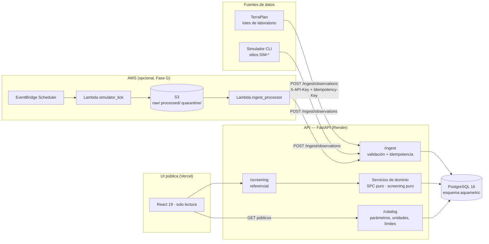
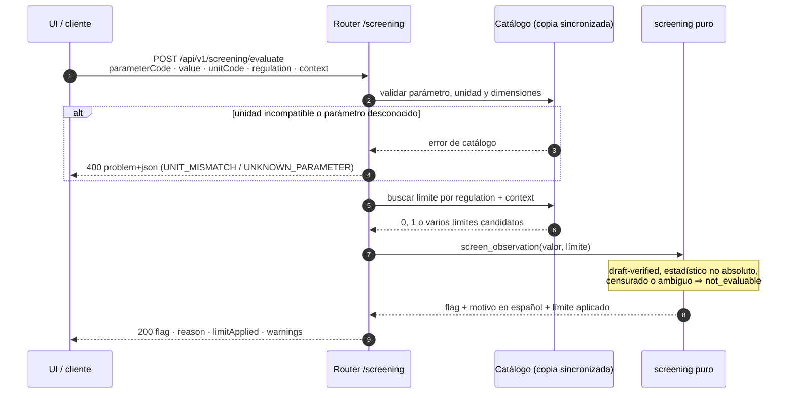
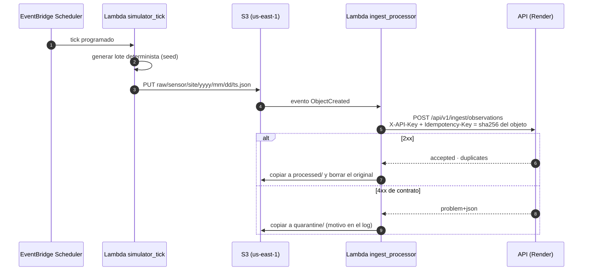
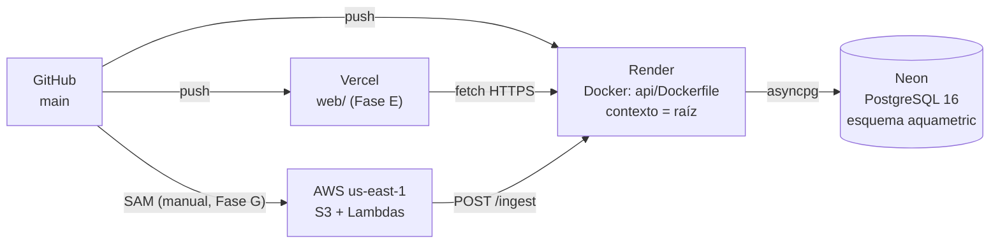

# Arquitectura de AquaMetric

Vista de conjunto para quien llega al repo: qué piezas existen, cómo se hablan y dónde vive cada
responsabilidad. Las decisiones y su justificación están en `docs/adr/`; las fórmulas
estadísticas, en `docs/spc-methods.md`; el vocabulario, en `docs/glossary.md`.

## 1. Vista general



La UI **nunca** escribe: no hay login ni formularios de carga. TerraPlan y el simulador entran por
el endpoint de ingesta; el pipeline AWS hace exactamente lo mismo que el simulador, solo que
programado.

## 2. Camino único de escritura

`POST /api/v1/ingest/observations` es el único lugar del sistema donde se crean observaciones
(ADR-002, ADR-009). Todo lo demás —TerraPlan, el CLI del simulador, la Lambda— es un cliente.

**Cabeceras**

| Cabecera | Obligatoria | Contenido |
|---|---|---|
| `X-API-Key` | sí | clave de ingesta (`INGEST_API_KEY`), comparada con `hmac.compare_digest` (ADR-011) |
| `Idempotency-Key` | sí | `sha256` del lote; misma key + mismo cuerpo ⇒ respuesta guardada |

**Cuerpo** (máximo 5 000 observaciones por lote)

```json
{
  "catalogVersion": "1.0.0",
  "site": { "id": "…", "code": "RIO-MAIPO-01", "name": "…", "waterBodyType": "river" },
  "samples": [{ "id": "…", "matrix": "water", "collectedAt": "2026-10-01T12:00:00Z" }],
  "observations": [{
    "id": "…", "siteId": "…", "sampleId": "…", "parameterCode": "TURB",
    "value": 4.2, "unitCode": "NTU", "analyzedAt": "2026-10-01T13:00:00Z",
    "qcFlag": "ok", "source": "lab"
  }]
}
```

**Respuesta `200`**: `{ "accepted": 42, "duplicates": 0 }`. Cualquier problema devuelve
`application/problem+json` con un código estable (`UNKNOWN_PARAMETER`, `UNIT_MISMATCH`,
`CATALOG_VERSION_MISMATCH`, `IDEMPOTENCY_KEY_REUSE`, `VALIDATION_ERROR`, `UNAUTHORIZED`) y **no se
guarda nada**: el lote es una sola transacción.

## 3. Capas

Dependencia unidireccional: `Router → Service → Repository → Model/DB`. Los módulos marcados
*puro* no conocen FastAPI, SQLAlchemy ni el reloj; reciben datos y devuelven resultados.

| Capa | Responsabilidad | Prohibido |
|---|---|---|
| **Router** (`api/app/routers/`) | HTTP, validación Pydantic, `Depends`, códigos de estado, OpenAPI | lógica de negocio, SQL, estadística |
| **Service** (`api/app/services/`) | reglas de negocio, orquestación, unidad de trabajo (commit) | leer `Request`, SQL suelto |
| **Repository** (`api/app/repositories/`) | consultas SQLAlchemy 2.0; recibe `AsyncSession` | `commit()`, reglas de negocio, `HTTPException` |
| **Model** (`api/app/models/`) | tablas tipadas en el esquema `aquametric` | lógica, defaults de negocio |
| **`spc/`** (puro) | límites de control, reglas de Nelson, capacidad, línea base | I/O, BD, red, `datetime.now()` |
| **`screening/`** (puro) | comparar un valor con un límite del catálogo | I/O, ambigüedad silenciosa |
| **`simulator/`** (puro + CLI) | generar series deterministas con eventos | escritura directa en BD (usa la API) |
| **`catalog/`** | cargar y validar el catálogo sincronizado | editar el catálogo |
| **`core/`** | config, BD, seguridad, errores, logging, reloj | reglas de dominio |

Un cambio que cruce capas hacia arriba (por ejemplo, un repositorio que lance `HTTPException`) es
un bug de arquitectura, no un atajo.

## 4. Base de datos

Todo en el esquema **`aquametric`** (ADR-008). `public` queda para TerraPlan.

| Tabla | Qué guarda | Notas |
|---|---|---|
| `site` | sitios de muestreo: `code` único, nombre, tipo de cuerpo de agua, coordenadas, `is_active` | upsert por `id`; `code` duplicado con otro `id` ⇒ `409 CONFLICT` |
| `sample` | muestras de campaña: sitio, matriz, `collected_at`, estado, recepción en laboratorio | se republica (upsert por `id`, actualiza `status`) |
| `observation` | la medición: sitio, muestra (o `NULL` si es sensor), parámetro, valor, unidad, `qualifier`, `loq`, `qc_flag`, `source`, `analyzed_at` | `UNIQUE uq_obs_natural_key` + `ON CONFLICT DO NOTHING`; censurados con `value = NULL` |
| `ingest_idempotency` | una fila por `Idempotency-Key`: hash del cuerpo, respuesta JSONB, estado, recibido en | permite devolver la misma respuesta sin reprocesar |
| `spc_baseline` | línea base por `(site, parameter, phase)`: `n`, rango de datos, método, `center_line`, `ucl`, `lcl`, versión del catálogo, `computed_at` | reproducible: mismos datos ⇒ mismos límites |

Índice principal: `ix_obs_site_param_time (site_id, parameter_code, analyzed_at)` cubre la
consulta más caliente (la serie que alimenta la carta). Sin particionamiento ni extensiones
exóticas (ADR-006).

## 5. Tres estados separados

Regla de producto, no detalle de implementación (ADR-010): un valor puede estar dentro del rango
y ser un dato dudoso, y ninguna de las dos cosas dice si el sitio cumple la norma.

| Estado | Pregunta | Valores | Dónde |
|---|---|---|---|
| `screeningFlag` | ¿está dentro del rango del catálogo? | `normal` · `above_range` · `below_range` · `not_evaluable` | `POST /screening/evaluate` |
| `dataQualityStatus` | ¿el dato es confiable? | `ok` · `suspect` · `failed` · censurado · sin valor | `qcFlag` de la observación |
| `regulatoryStatus` | ¿cumple la norma? | siempre `not_evaluable` en el MVP | no se calcula |

La UI los muestra por separado, con estilos distintos, y nunca escribe «Cumple» ni «Excede».

## 6. Flujo del screening



El screening **no toca la base de datos**: compara el valor contra el catálogo en memoria y se
calcula siempre al leer (nunca se persiste, para que no quede obsoleto al cambiar el catálogo).

## 7. Pipeline AWS (opcional)



Consecuencias prácticas: la Lambda no conoce PostgreSQL, sus permisos IAM se limitan al bucket, y
la demo viva no depende de este pipeline (ADR-002, ADR-004). Si se recorta por plazo, la API y la
UI siguen funcionando igual.

## 8. Despliegue



`render.yaml` fija `dockerfilePath: ./api/Dockerfile` y `dockerContext: .` porque la imagen
necesita la copia del catálogo (ADR-016). El health check es `GET /api/v1/health`; UptimeRobot lo
consulta para mitigar el cold start del plan free (ADR-004).

## 9. Referencias

- `.clinerules/01-project-context.md` §3 (arquitectura y capas)
- `docs/adr/` — 001 (límites Fase I), 002 (pipeline), 004 (Render), 006 (PostgreSQL), 008 (esquema
  `aquametric`), 009 (ingesta atómica), 010 (screening referencial), 011 (API key)
- `docs/spc-methods.md` (fórmulas), `docs/glossary.md` (vocabulario)
- `docs/design-system.md` (UI), `api/app/` (implementación)


